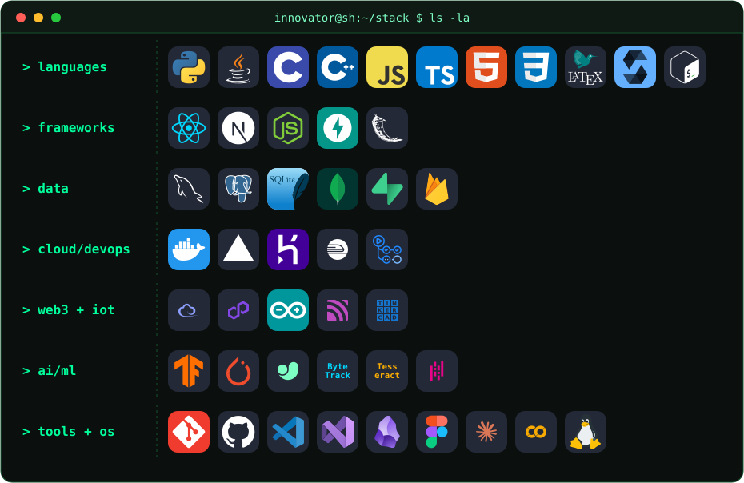
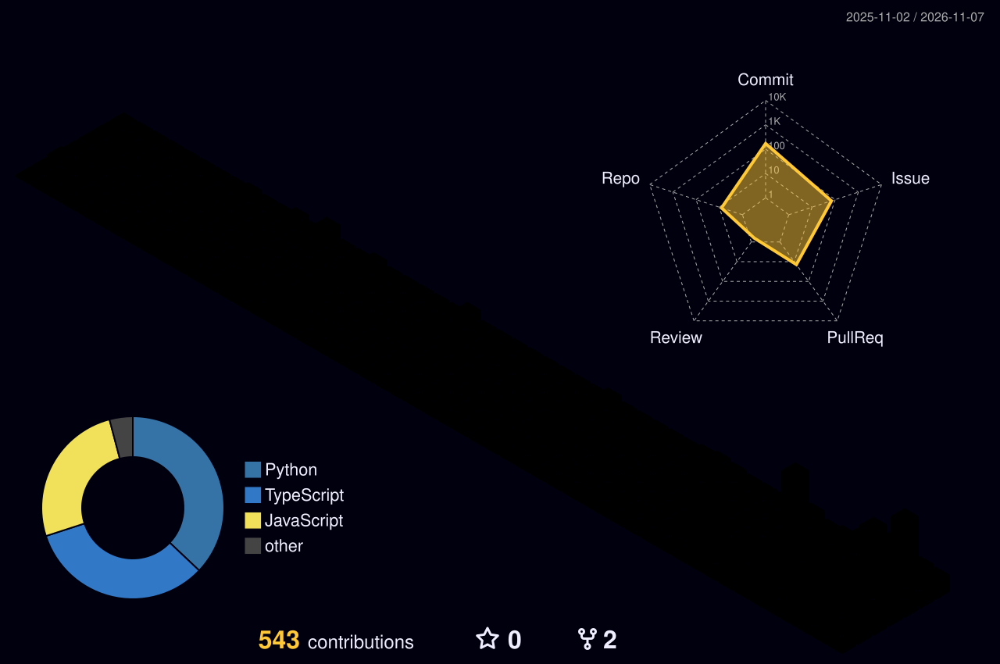

<div align="center">


[](https://github.com/innovator-sh)


</div>

```console
root@innovator:~# nmap -sV --top-ports 5 innovator-sh.local

Starting Nmap 7.95 ( https://nmap.org ) at boot
Nmap scan report for innovator-sh (127.0.0.1)
Host is up (0.00042s latency).

PORT      STATE  SERVICE        VERSION
22/tcp    open   curiosity      always-on
80/tcp    open   web            full-stack, exposed on purpose
443/tcp   open   security       encrypted by default
1337/tcp  open   build          ships weekly
31337/tcp open   experiments    here be dragons 🐉

Scan complete. The most exploitable surface is still the human mind.
root@innovator:~# _
```

## 🛰️ Tech and Tools I use

<div align="center">



</div>

## 🚀 Featured Projects

<table>
  <tr>
    <td width="50%" valign="top">
      <h3 align="center"><a href="https://github.com/innovator-sh/Traan">Traan</a></h3>
      <p align="center">Crisis coordination layer – reads voice notes, maps disasters in real time, dispatches volunteers</p>
      <p align="center">
        <a href="https://github.com/innovator-sh/Traan/stargazers"></a>
        
      </p>
    </td>
    <td width="50%" valign="top">
      <h3 align="center"><a href="https://github.com/innovator-sh/vidyaai">VidyaAI</a></h3>
      <p align="center">VidyaAI is an RAG AI tutor that answers questions from students</p>
      <p align="center">
        <a href="https://github.com/innovator-sh/vidyaai/stargazers"></a>
        
      </p>
    </td>
  </tr>
  <tr>
    <td width="50%" valign="top">
      <h3 align="center"><a href="https://github.com/innovator-sh/jurisai">JurisAI</a></h3>
      <!-- TODO: add a one-line description -->
      <p align="center">AI for the legal domain</p>
      <p align="center">
        <a href="https://github.com/innovator-sh/jurisai/stargazers"></a>
        
      </p>
    </td>
    <td width="50%" valign="top">
      <h3 align="center"><a href="https://github.com/innovator-sh/trust-lend">Trust-Lend</a></h3>
      <!-- TODO: add a one-line description -->
      <p align="center">Trust-based lending platform</p>
      <p align="center">
        <a href="https://github.com/innovator-sh/trust-lend/stargazers"></a>
        
      </p>
    </td>
  </tr>
</table>

## 📊 GitHub Stats

<p align="center">
  
  
</p>

<p align="center">
  
</p>

## 🐍 Contribution Visuals

<p align="center">
  <picture>
    <source media="(prefers-color-scheme: dark)" srcset="https://raw.githubusercontent.com/innovator-sh/innovator-sh/output/github-contribution-grid-snake-dark.svg" />
    <source media="(prefers-color-scheme: light)" srcset="https://raw.githubusercontent.com/innovator-sh/innovator-sh/output/github-contribution-grid-snake.svg" />
    
  </picture>
</p>

<p align="center">
  
</p>

## 📡 Establish a Connection


<p align="center">
  <a href="https://github.com/innovator-sh"></a>
  <a href="https://www.instagram.com/innovator.sh/"></a>
  <a href="mailto:itzinnovator01@gmail.com"></a>
</p>

<div align="center">

```text
[ connection closed by remote host ] — see you on the next packet.
```


</div>
